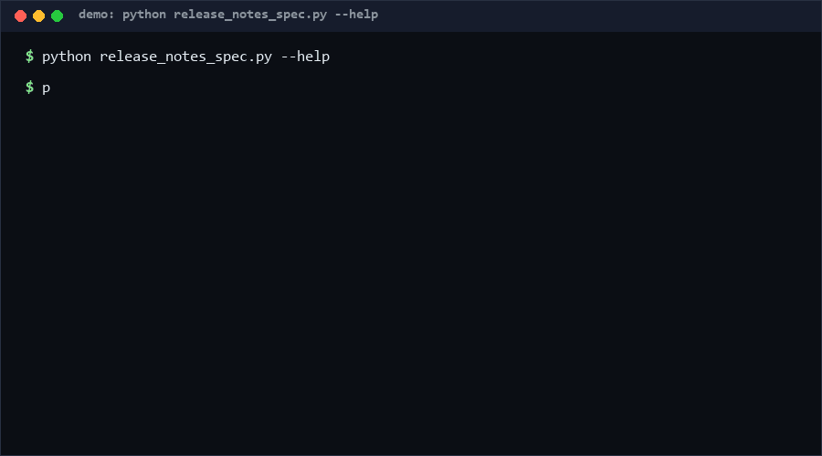

# release-notes-spec

A validator that keeps your Markdown release notes honest. It checks version
headings, standard sections, dates, bullet formatting, and — the part humans
forget — that every **BREAKING** change is paired with an Upgrade/Migration
section. Drop it into CI next to your changelog. If your release notes are
already machine-generated from a strict template, you may not need it.

<p align="center"></p>

## Problem

Release notes rot silently. Someone adds a `### Wibbles` section, another
release ships a breaking API removal with no migration path, dates drift out
of `YYYY-MM-DD`, and downstream users find out at runtime. Keep a Changelog
gives conventions; nothing cheap and offline *enforces* them on a Markdown
file in a pull request.

## How it works

The validator parses a single Markdown file into releases and sections:

- **Release headings**: `## [1.2.3] - 2026-10-13`, `## v2.0.0-rc.1`, or
  `## Unreleased` / `Next` / `Upcoming`. Malformed versions (`1.2`) and
  malformed dates (`2026-1-1`) are errors; a real version without any date is
  a warning.
- **Sections**: the Keep-a-Changelog set — `Added`, `Changed`, `Deprecated`,
  `Removed`, `Fixed`, `Security`. Other names warn; duplicates within one
  release error; empty sections warn.
- **Items**: bullets (`- `) are items; bare prose under a section warns.
- **The coupling rule**: any item containing `**BREAKING**` or starting with
  `breaking:` forces an `Upgrade` or `Migration` section in the same release,
  else error. This is the rule that saves your users' weekend.

Exit 0 = no errors (warnings allowed), 1 = errors, 2 = unreadable input.

## Quickstart (~2 min)

```bash
# 30 s: validate your changelog
python release_notes_spec.py validate CHANGELOG.md

# 30 s: get a compliant template to start from
python release_notes_spec.py init > CHANGELOG.md

# 1 min: JSON findings for CI annotation
python release_notes_spec.py validate CHANGELOG.md --format json
```

## Why not X?

- **release-notes/release-notes-spec**: the closest prior art — a
  community spec for an easy, human-readable, machine-processable
  `release-notes.yml` YAML schema with version/date/modification-list rules.
  It *defines* a format; it ships no checker you can point at a Markdown
  changelog. This repo validates the Markdown changelogs people actually
  write, and adds the breaking→upgrade coupling rule.
- **semantic-release / conventional-changelog**: they *generate* notes from
  commit messages. Great until someone hand-edits the output or the tooling
  is adopted mid-project; nothing re-validates the artifact afterwards.
- **markdownlint**: general Markdown style (heading hierarchy, list style).
  It has no concept of a release, a section vocabulary, or breaking-change
  semantics — you would need a custom plugin per rule anyway.

## How this differs from release-notes/release-notes-spec

That repository works out a YAML schema specification for release notes
stored in `release-notes.yml`, with RFC-2119 MUST/SHOULD rules about title,
description, and per-release modification lists. This repo is not a competing
schema: it is a runnable checker for the *Markdown* changelog convention
(Keep-a-Changelog style) already used by millions of repos. Its rules
overlap on version/date/section structure but add behavior the spec does not
cover — coupling BREAKING items to migration guidance — and it executes
locally with zero dependencies rather than defining a new document format.

## Performance

[Measured] Windows 10, Python 3.13, 2026-10-13: validating a 50-release
changelog (~450 lines) took **4.5 ms** in-process (median of 50 runs).
Cold start adds ~300 ms interpreter startup. Parsing is a single linear
scan: O(lines).

Reproduce:

```bash
python - <<'EOF'
import io, time, contextlib, tempfile, os
import release_notes_spec as m
body = "# Changelog\n\n" + "".join(
    "## 1.0.%d - 2026-01-%02d\n\n### Added\n- feat %d\n\n### Fixed\n- **BREAKING** fix %d\n\n### Upgrade\n- step %d\n"
    % (i, (i % 28) + 1, i, i, i) for i in range(50))
p = os.path.join(tempfile.mkdtemp(), "n.md")
open(p, "w", encoding="utf-8", newline="").write(body)
t = time.perf_counter()
for _ in range(50):
    with contextlib.redirect_stdout(io.StringIO()):
        m.main(["validate", p, "--format", "json"])
print("warm_ms=%.1f" % ((time.perf_counter() - t) / 50 * 1000))
EOF
```

## Minimal Fallback

`release_notes_spec.py init` prints a compliant template — copy it, keep the
six section names, and put `**BREAKING**` only in releases that have an
`### Upgrade` block. That single discipline catches ~80% of the value with
zero tooling; the validator exists to keep humans honest at scale.

## Design Trade-offs

Priority order: **zero false positives > coverage > strictness**. Unknown
sections and missing dates are warnings, not errors, because real changelogs
have legitimate oddities and a validator that cries wolf gets removed from
CI in a week. Duplicate sections and breaking-without-upgrade are errors —
they mislead machines and users respectively, and we have never seen a
legitimate case for either. Date *shape* is enforced but calendar validity
(2026-13-99) is not; a full date parser was rejected as over-engineering.

## Limits & Second-order Effects

- Regex-based Markdown parsing: HTML-embedded changelogs or exotic heading
  styles are not understood. It targets the plain Markdown files on disk.
- If CI gates on this, teams may satisfy the letter (`### Upgrade` with one
  useless bullet) while users still lack real migration steps — review the
  content, not just the verdict.
- Enforcing the section vocabulary can suppress useful non-standard sections
  (`Internals`, `Performance`); the tool warns instead of errors on purpose.

## FAQ

**Q: Can I add my own required sections?**
A: Yes — extend `SECTIONS` and promote its absence from warning to error in
`validate_notes`; it is a 2-line change by design.

**Q: Does it modify my changelog?**
A: Never. `init` prints a template to stdout; `validate` is read-only.

**Q: When NOT to use this?**
A: If your notes are generated exclusively by semantic-release from commit
conventions and never hand-edited, the validator adds a gate with no
information. Also skip it for YAML/JSON changelog formats (use the spec
repo's tooling instead).

## [Core Assumptions]

1. Keep-a-Changelog's six-section vocabulary is the de facto standard worth
   enforcing on Markdown changelogs.
2. Breaking changes without migration guidance are a defect of the notes,
   not just of the release — hence the coupling rule is an error.
3. Changelogs are hand-edited often enough that generated-only pipelines
   leave a real validation gap.
4. Warnings should not fail CI; only machine-misleading (duplicates) and
   user-harming (breaking w/o upgrade) issues should.

Confidence: **High (≥80%)** that the breaking→upgrade coupling rule matches
what changelog readers need — it mirrors how maintainers communicate
migrations in practice. **Medium (60–79%)** that the six-section vocabulary
is the right enforcement set for your project; treat it as configurable.

*Data and measurements as of 2026-10-13.*

---

Part of the [zhengming-toolbox](https://github.com/chenhz01/zhengming-toolbox) — 105 purpose-built AI-engineering tools across neglected niches.

Related tools: [upgrade-risk-grader](https://github.com/chenhz01/upgrade-risk-grader) · [cli-help-spec](https://github.com/chenhz01/cli-help-spec) · [code-block-lang-check](https://github.com/chenhz01/code-block-lang-check)
